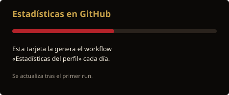
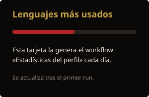

  
  
  

<h2 align="center">Sobre mí</h2>

  Soy <b>Camilo</b>, estudiante de <b>Ingeniería de Sistemas</b> en la UFPS, en Cúcuta, Colombia (carrera en curso). 
  Me presento como <b>Software Developer</b> y estoy <b>disponible para trabajo, prácticas y proyectos</b>. 
  Me gusta construir cosas que se sientan bien al usarlas: herramientas web rápidas, interfaces cuidadas y código que otros puedan entender. 
  Vengo de Java y la programación orientada a objetos, y hoy me muevo entre TypeScript, React y Python. 
  Trabajo por pasos, con un commit por cada paso: en cada repo se ve cómo fue avanzando el proyecto desde el inicio.

<i>Fuera del código: tenis de mesa y videojuegos.</i>

<h2 align="center">Stack</h2>

  

<h2 align="center">Proyectos destacados</h2>

<table>
  <tr>
    <td align="center" valign="top" width="50%" colspan="2">
      
        
      <b>Portafolio</b>
       
      Mi portafolio personal: un claroscuro tipo pintura al óleo con guiños a la cultura gamer. Muestra quién soy, mi stack, mis proyectos y la música que me acompaña.
        
           
        
      <a href="https://dcportafolio.vercel.app"><b>Ver sitio</b></a> · <a href="https://github.com/Camilo0812A/portfolio"><b>Código</b></a>
    </td>
  </tr>
  <tr>
    <td align="center" valign="top" width="50%">
      
        
      <b>Promptazo</b>
       
      Generador web gratuito que convierte un formulario corto en prompts profesionales (presentaciones, CV para filtros ATS y guías de estudio), en español e inglés.
        
          
        
      <a href="https://promptazo.kodce.com"><b>Ver sitio</b></a> · <i>Repo privado</i>
    </td>
    <td align="center" valign="top" width="50%">
      
        
      <b>Tuned Boyer-Moore Simulator</b>
       
      Simulador interactivo del algoritmo de búsqueda de cadenas Tuned Boyer-Moore: paso a paso, con línea de tiempo y tabla bmBc.
        
       
        
      <a href="https://github.com/Camilo0812A/tuned-boyer-moore-simulator"><b>Código</b></a>
    </td>
  </tr>
  <tr>
    <td align="center" valign="top" width="50%">
      
        
      <b>Parcial ADA · Entrenador de Análisis de Algoritmos</b>
       
      Minijuego web 100 % offline para practicar T(n), Big-O y Ω y el diseño de algoritmos para el primer parcial.
        
         
        
      <a href="https://camilo0812a.github.io/parcial-ada-analisis/"><b>Ver sitio</b></a> · <a href="https://github.com/Camilo0812A/parcial-ada-analisis"><b>Código</b></a>
    </td>
    <td align="center" valign="top" width="50%">
      
        
      <b>Clima React</b>
       
      Buscador de pronóstico: clima de hoy y próximos 7 días de cualquier ciudad, con la API gratuita de Open-Meteo.
        
        
        
      <a href="https://camilo0812a.github.io/clima-react/"><b>Ver sitio</b></a> · <a href="https://github.com/Camilo0812A/clima-react"><b>Código</b></a>
    </td>
  </tr>
  <tr>
    <td align="center" valign="top" width="50%" colspan="2">
      
        
      <b>Mesa de ayuda · Tablero de tickets</b>
       
      Tablero para gestionar tickets de soporte de una oficina, con API REST sobre json-server.
        
         
        
      <a href="https://github.com/Camilo0812A/tablero-soporte"><b>Código</b></a> · <i>Se corre en local</i>
    </td>
  </tr>
</table>

<h2 align="center">Actividad</h2>

<picture>
  <source media="(prefers-color-scheme: dark)" srcset="https://raw.githubusercontent.com/Camilo0812A/Camilo0812A/output/github-snake-dark.svg">
  <source media="(prefers-color-scheme: light)" srcset="https://raw.githubusercontent.com/Camilo0812A/Camilo0812A/output/github-snake.svg">
  
</picture>

  

  

<h2 align="center">Contacto</h2>

  ¿Tienes una vacante, una práctica o un proyecto en mente? <b>Hablemos</b>, <i>¿creamos algo?</i> 
  Escríbeme a <a href="mailto:dcolmenaresh1@gmail.com">dcolmenaresh1@gmail.com</a> o visita mi <a href="https://dcportafolio.vercel.app">portafolio</a>.

  
  
  

