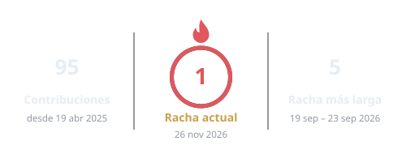

<picture>
  <source media="(prefers-color-scheme: dark)" srcset="assets/banner-dark.svg">
  <source media="(prefers-color-scheme: light)" srcset="assets/banner-light.svg">
  
</picture>

<a href="https://dcportafolio.kodce.com">
  <picture>
    <source media="(prefers-color-scheme: dark)" srcset="https://readme-typing-svg.demolab.com/?font=JetBrains+Mono&weight=500&size=22&duration=2600&pause=900&color=C8A24A&background=00000000&center=true&vCenter=true&repeat=false&width=640&height=44&lines=Software%20Developer;Estudiante%20de%20Ingenier%C3%ADa%20de%20Sistemas;Java%20%C2%B7%20TypeScript%20%C2%B7%20React%20%C2%B7%20Python;Disponible%20para%20trabajo,%20pr%C3%A1cticas%20y%20proyectos">
    <source media="(prefers-color-scheme: light)" srcset="https://readme-typing-svg.demolab.com/?font=JetBrains+Mono&weight=500&size=22&duration=2600&pause=900&color=9A7A2C&background=00000000&center=true&vCenter=true&repeat=false&width=640&height=44&lines=Software%20Developer;Estudiante%20de%20Ingenier%C3%ADa%20de%20Sistemas;Java%20%C2%B7%20TypeScript%20%C2%B7%20React%20%C2%B7%20Python;Disponible%20para%20trabajo,%20pr%C3%A1cticas%20y%20proyectos">
    
  </picture>
</a>

  
  
  

<h2 align="center">Sobre mí</h2>

  Soy <b>Camilo</b>, estudiante de <b>Ingeniería de Sistemas</b> en la UFPS, en Cúcuta, Colombia (carrera en curso). 
  Me presento como <b>Software Developer</b> y estoy <b>disponible para trabajo, prácticas y proyectos</b>. 
  Me gusta construir cosas que se sientan bien al usarlas: herramientas web rápidas, interfaces cuidadas y código que otros puedan entender. 
  Vengo de Java y la programación orientada a objetos, y hoy me muevo entre TypeScript, React y Python. 
  Trabajo por pasos, con un commit por cada paso: en cada repo se ve cómo fue avanzando el proyecto desde el inicio.

<i>Fuera del código: tenis de mesa y videojuegos.</i>

<h2 align="center">Stack</h2>

  <a href="https://skillicons.dev">
    <picture>
      <source media="(prefers-color-scheme: dark)" srcset="https://skillicons.dev/icons?i=java,python,c,cpp,js,ts,react,html,css,tailwind,astro,postgres,mysql,django,git,github,linux,vscode,vite,vercel&perline=10&theme=dark">
      <source media="(prefers-color-scheme: light)" srcset="https://skillicons.dev/icons?i=java,python,c,cpp,js,ts,react,html,css,tailwind,astro,postgres,mysql,django,git,github,linux,vscode,vite,vercel&perline=10&theme=light">
      
    </picture>
  </a>

<h2 align="center">Proyectos destacados</h2>

<table>
  <tr>
    <td align="center" valign="top" width="50%">
      
       
      <h3>Portafolio</h3>
      Mi portafolio personal: un claroscuro tipo pintura al óleo con guiños a la cultura gamer. Muestra quién soy, mi stack, mis proyectos y la música que me acompaña.
        
      <code>React</code> <code>TypeScript</code> <code>Vite</code> <code>Tailwind CSS</code> <code>Motion</code> <code>WebGL2</code>
        
      <a href="https://dcportafolio.kodce.com"><b>Ver sitio</b></a> · <a href="https://github.com/Camilo0812A/portfolio"><b>Código</b></a>
    </td>
    <td align="center" valign="top" width="50%">
      
       
      <h3>Promptazo</h3>
      Generador web gratuito que convierte un formulario corto en prompts profesionales (presentaciones, CV para filtros ATS y guías de estudio), en español e inglés.
        
      <code>TypeScript</code> <code>Vitest</code> <code>Playwright</code> <code>Cloudflare Pages</code>
        
      <a href="https://promptazo.kodce.com"><b>Ver sitio</b></a> · <i>Repo privado</i>
    </td>
  </tr>
</table>

<table>
  <tr>
    <td align="center" valign="top" width="50%">
      
       
      <h3>Tuned Boyer-Moore Simulator</h3>
      Simulador interactivo del algoritmo de búsqueda de cadenas Tuned Boyer-Moore: paso a paso, con línea de tiempo y tabla bmBc.
        
      <code>HTML</code> <code>JavaScript</code>
        
      <a href="https://github.com/Camilo0812A/tuned-boyer-moore-simulator"><b>Código</b></a>
    </td>
    <td align="center" valign="top" width="50%">
      
       
      <h3>Parcial ADA</h3>
      Entrenador de análisis de algoritmos: minijuego web 100 % offline para practicar T(n), Big-O y Ω y el diseño de algoritmos para el primer parcial.
        
      <code>HTML</code> <code>CSS</code> <code>JavaScript</code> <code>KaTeX</code>
        
      <a href="https://camilo0812a.github.io/parcial-ada-analisis/"><b>Ver sitio</b></a> · <a href="https://github.com/Camilo0812A/parcial-ada-analisis"><b>Código</b></a>
    </td>
  </tr>
</table>

<table>
  <tr>
    <td align="center" valign="top" width="50%">
      
       
      <h3>Clima React</h3>
      Buscador de pronóstico: clima de hoy y próximos 7 días de cualquier ciudad, con la API gratuita de Open-Meteo.
        
      <code>React</code> <code>Vite</code> <code>CSS</code>
        
      <a href="https://camilo0812a.github.io/clima-react/"><b>Ver sitio</b></a> · <a href="https://github.com/Camilo0812A/clima-react"><b>Código</b></a>
    </td>
    <td align="center" valign="top" width="50%">
      
       
      <h3>Mesa de ayuda · Tablero de tickets</h3>
      Tablero para gestionar tickets de soporte de una oficina, con API REST sobre json-server.
        
      <code>HTML</code> <code>Tailwind CSS</code> <code>JavaScript</code> <code>json-server</code>
        
      <a href="https://github.com/Camilo0812A/tablero-soporte"><b>Código</b></a> · <i>Se corre en local</i>
    </td>
  </tr>
</table>

<h2 align="center">Actividad</h2>

<picture>
  <source media="(prefers-color-scheme: dark)" srcset="https://raw.githubusercontent.com/Camilo0812A/Camilo0812A/output/github-snake-dark.svg">
  <source media="(prefers-color-scheme: light)" srcset="https://raw.githubusercontent.com/Camilo0812A/Camilo0812A/output/github-snake.svg">
  
</picture>

  

<picture>
  <source media="(prefers-color-scheme: dark)" srcset="assets/stats/stats-dark.svg">
  <source media="(prefers-color-scheme: light)" srcset="assets/stats/stats-light.svg">
  
</picture>
<picture>
  <source media="(prefers-color-scheme: dark)" srcset="assets/stats/top-langs-dark.svg">
  <source media="(prefers-color-scheme: light)" srcset="assets/stats/top-langs-light.svg">
  
</picture>
  
<picture>
  <source media="(prefers-color-scheme: dark)" srcset="assets/stats/streak-dark.svg">
  <source media="(prefers-color-scheme: light)" srcset="assets/stats/streak-light.svg">
  
</picture>

<h2 align="center">Contacto</h2>

  ¿Tienes una vacante, una práctica o un proyecto en mente? <b>Hablemos</b>, <i>¿creamos algo?</i> 
  Escríbeme a <a href="mailto:dcolmenaresh1@gmail.com">dcolmenaresh1@gmail.com</a> o visita mi <a href="https://dcportafolio.kodce.com">portafolio</a>.

  
  
  

 

Hecho por Camilo Colmenares

